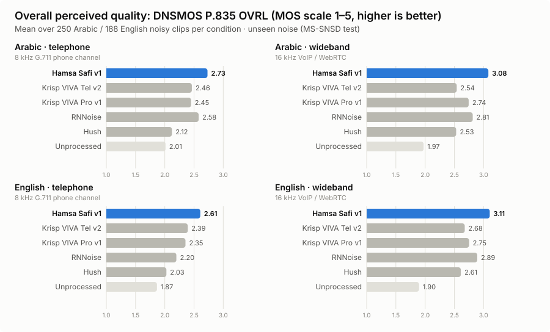

# Hamsa Safi v1

**Real-time noise suppression built for Arabic voice agents.** Hamsa Safi v1 is a streaming speech-enhancement model from
Hamsa AI for voice agents, contact centres and VoIP. It processes 10 ms frames on a single CPU core with ~30 ms delay.

On an independent benchmark of 876 synthetic and 200 real noisy clips, compared with Krisp VIVA (Tel v2, Pro v1), RNNoise and Hush:

- **Highest perceived quality in every condition:** best DNSMOS OVRL on Arabic and English, phone and wideband, synthetic and
  real recordings. On real Arabic recordings it is rated higher than Krisp Tel v2 on **82%** of clips (16 kHz) and **70%** over a phone line.
- **Best speech recognition on wideband audio:** **48% lower** Whisper error than Krisp Tel v2 on Arabic and **40% lower** on English.
  On phone audio Safi and Krisp Tel v2 are on par (differences within ±3%, not statistically significant).
- **Fewer false voice triggers from background talkers:** 4.0 false VAD triggers per minute on phone audio against 5.7 for Krisp Tel v2
  (statistically significant), so a voice agent is interrupted less by people talking nearby.
- **Arabic phone PESQ above Krisp Tel v2** (2.66 vs 2.60) and best or tied-best on all six quality metrics on Arabic wideband.

### ▶ [Listen to the samples and explore the interactive benchmark](https://hamsa-ai.github.io/hamsa-safi-v1/)

<p align="center"></p>

## Why a new benchmark

Most published speech-enhancement results use English VoiceBank-DEMAND, which overlaps with common training corpora
(VCTK, DEMAND) and says little about Arabic. To measure fairly, we built a test set **Safi never saw**:

- **Speech:** FLEURS test split. Egyptian Arabic, 250 utterances. US English, 188 utterances.
- **Noise:** MS-SNSD `noise_test`: babble, neighbour talking, airport announcements, air conditioner, typing, door slams,
  copy machine, vacuum cleaner, eating. Mixed at −5 to +15 dB SNR.
- **Two channels:** 16 kHz wideband (WebRTC / VoIP) and a simulated phone line (300–3400 Hz, 8 kHz, G.711 μ-law).
- **Real recordings:** 100 genuinely noisy Arabic Common Voice clips (no added noise), as recorded and through the phone channel.
- **Same conditions for every system:** real-time streaming at 10 ms frames, full suppression strength, fresh session per
  clip, and each system's delay compensated before scoring. Only streaming-capable systems are compared.
- **Statistics:** every Safi-vs-system gap has a paired-bootstrap 95% confidence interval (2,000 resamples) in [`results/`](results/).
  We call a difference a win only when its interval excludes zero.

## Audio quality

Means over all clips. **Bold** = best processed system per column.

#### Arabic · telephone  
<sub>8 kHz G.711 phone channel · n = 250 clips</sub>

| System | PESQ | STOI | SI-SDR (dB) | DNSMOS SIG | DNSMOS BAK | DNSMOS OVRL |
|---|---:|---:|---:|---:|---:|---:|
| **Hamsa Safi v1** | **2.66** | 0.828 | **11.30** | **3.02** | **3.97** | **2.73** |
| Krisp VIVA Tel v2 | 2.60 | **0.851** | 10.87 | 2.72 | 3.89 | 2.46 |
| Krisp VIVA Pro v1 | 2.53 | 0.844 | 8.59 | 2.71 | 3.88 | 2.45 |
| RNNoise | 2.12 | 0.792 | 7.72 | 2.90 | 3.80 | 2.58 |
| Hush | 1.85 | 0.690 | 1.28 | 2.49 | 3.58 | 2.12 |
| Unprocessed | 1.99 | 0.792 | 5.73 | 2.69 | 2.28 | 2.01 |

#### Arabic · wideband  
<sub>16 kHz VoIP / WebRTC · n = 250 clips</sub>

| System | PESQ | STOI | SI-SDR (dB) | DNSMOS SIG | DNSMOS BAK | DNSMOS OVRL |
|---|---:|---:|---:|---:|---:|---:|
| **Hamsa Safi v1** | **2.19** | **0.892** | **12.68** | **3.38** | **3.99** | **3.08** |
| Krisp VIVA Tel v2 | 1.81 | 0.783 | 6.70 | 2.81 | 3.88 | 2.54 |
| Krisp VIVA Pro v1 | 1.91 | 0.872 | 7.92 | 3.01 | 3.94 | 2.74 |
| RNNoise | 1.60 | 0.856 | 8.98 | 3.18 | 3.78 | 2.81 |
| Hush | 1.56 | 0.793 | 4.73 | 3.05 | 3.36 | 2.53 |
| Unprocessed | 1.33 | 0.794 | 4.21 | 2.69 | 2.07 | 1.97 |

#### English · telephone  
<sub>8 kHz G.711 phone channel · n = 188 clips</sub>

| System | PESQ | STOI | SI-SDR (dB) | DNSMOS SIG | DNSMOS BAK | DNSMOS OVRL |
|---|---:|---:|---:|---:|---:|---:|
| **Hamsa Safi v1** | **2.08** | 0.682 | 6.02 | **2.89** | **4.03** | **2.61** |
| Krisp VIVA Tel v2 | 2.06 | **0.717** | **6.13** | 2.66 | 3.94 | 2.39 |
| Krisp VIVA Pro v1 | 1.96 | 0.706 | 4.97 | 2.62 | 3.92 | 2.35 |
| RNNoise | 1.50 | 0.468 | -4.54 | 2.49 | 3.88 | 2.20 |
| Hush | 1.64 | 0.570 | -0.73 | 2.36 | 3.70 | 2.03 |
| Unprocessed | 2.00 | 0.709 | 3.96 | 2.57 | 2.05 | 1.87 |

#### English · wideband  
<sub>16 kHz VoIP / WebRTC · n = 188 clips</sub>

| System | PESQ | STOI | SI-SDR (dB) | DNSMOS SIG | DNSMOS BAK | DNSMOS OVRL |
|---|---:|---:|---:|---:|---:|---:|
| **Hamsa Safi v1** | **1.74** | **0.763** | **9.21** | **3.37** | **4.07** | **3.11** |
| Krisp VIVA Tel v2 | 1.54 | 0.703 | 6.34 | 2.94 | 3.95 | 2.68 |
| Krisp VIVA Pro v1 | 1.56 | 0.737 | 7.12 | 3.01 | 3.99 | 2.75 |
| RNNoise | 1.44 | 0.701 | 5.45 | 3.20 | 3.92 | 2.89 |
| Hush | 1.43 | 0.678 | 3.56 | 3.08 | 3.52 | 2.61 |
| Unprocessed | 1.34 | 0.708 | 4.04 | 2.63 | 1.96 | 1.90 |


Every DNSMOS lead over both Krisp models is statistically significant (Safi rated higher on 91–98% of clips per condition).

## Real-world recordings

Synthetic mixtures are controlled; real calls are not. We ran every system on **100 genuinely noisy Arabic recordings** from
Mozilla Common Voice (CC0): crowd recordings made on people's own laptops and phones, with real rooms, fans, traffic and echo,
and no added noise. We searched all ~66,000 Arabic clips for heavy background noise (estimated SNR below 25 dB), then kept the 100 noisiest whose
speech is still intelligible, one per speaker. They're scored with DNSMOS P.835, since no clean reference exists, both as recorded
and through a G.711 phone channel.

| System | DNSMOS OVRL (16 kHz) | DNSMOS OVRL (phone channel) |
|---|---:|---:|
| **Hamsa Safi v1** | **2.82** | **2.56** |
| Krisp VIVA Tel v2 | 2.64 | 2.44 |
| Krisp VIVA Pro v1 | 2.55 | 2.42 |
| RNNoise | 2.59 | 2.04 |
| Hush | 2.38 | 1.98 |
| Original recording | 2.15 | 2.26 |

## Speech recognition

Every output was transcribed with an independent recogniser, OpenAI Whisper large-v3 (not trained or tuned by us), and scored
against the human transcripts by character error rate (CER, the usual primary metric for Arabic, where attached clitics make WER
volatile) and word error rate (WER). The relative figure uses the other system's error as the baseline:
(other − Safi) / other. For example, 25.4% → 13.3% is 48% lower.

**Safi's error rate relative to each system** (CER; the other system's error is the baseline: (other − Safi) / other. **Bold** = statistically significant, 95% paired bootstrap; "on par" = interval includes zero)

| Safi vs | Arabic wideband | Arabic phone | Arabic real, 16 kHz | Arabic real, phone | English wideband | English phone |
|---|---:|---:|---:|---:|---:|---:|
| Krisp VIVA Tel v2 | **48% lower** | on par (2% lower) | on par (2% lower) | on par (3% higher) | **40% lower** | on par (3% lower) |
| Krisp VIVA Pro v1 | **24% lower** | on par (2% lower) | **17% lower** | on par (14% lower) | **21% lower** | **13% lower** |
| RNNoise | **33% lower** | **25% lower** | **38% lower** | **54% lower** | **45% lower** | **55% lower** |
| Hush | **41% lower** | **43% lower** | **39% lower** | **49% lower** | **40% lower** | **42% lower** |

**Character error rate (CER)**, lower is better

| System | Arabic wideband | Arabic phone | Arabic real, 16 kHz | Arabic real, phone | English wideband | English phone |
|---|---:|---:|---:|---:|---:|---:|
| **Hamsa Safi v1** | **13.3%** | **24.6%** | **15.9%** | 28.2% | **13.4%** | **26.2%** |
| Krisp VIVA Tel v2 | 25.4% | 25.2% | 16.3% | **27.3%** | 22.5% | 27.0% |
| Krisp VIVA Pro v1 | 17.4% | 25.0% | 19.2% | 32.9% | 17.0% | 30.1% |
| RNNoise | 19.9% | 32.9% | 25.5% | 61.9% | 24.5% | 57.7% |
| Hush | 22.6% | 43.5% | 26.0% | 54.9% | 22.5% | 44.8% |

**Word error rate (WER)**, lower is better

| System | Arabic wideband | Arabic phone | Arabic real, 16 kHz | Arabic real, phone | English wideband | English phone |
|---|---:|---:|---:|---:|---:|---:|
| **Hamsa Safi v1** | **26.5%** | **41.2%** | **33.2%** | 49.8% | **20.5%** | **34.8%** |
| Krisp VIVA Tel v2 | 39.5% | 43.3% | 33.5% | **49.4%** | 30.2% | 36.7% |
| Krisp VIVA Pro v1 | 31.9% | 43.9% | 37.7% | 53.4% | 25.0% | 40.3% |
| RNNoise | 35.5% | 51.0% | 44.1% | 80.0% | 34.8% | 68.8% |
| Hush | 38.3% | 60.8% | 45.7% | 75.0% | 31.2% | 55.3% |

Wideband gains over both Krisp models are statistically significant. On phone audio, differences between Safi and Krisp Tel v2 are
within ±3% and not statistically significant in either direction: the two are on par.

## Voice activity detection

Voice agents decide when the caller is talking with a VAD, usually Silero. We ran Silero VAD v6 (default settings, threshold 0.5)
on every system's output and compared it, frame by frame, with speech labels from the clean reference.

**Speech clips:** missed speech (caller speech the VAD did not detect), false alarm (noise-only frames flagged as speech), F1. Lower, lower, higher is better.

| System | Arabic phone: missed / false alarm / F1 | Arabic wideband: missed / false alarm / F1 | English phone: missed / false alarm / F1 | English wideband: missed / false alarm / F1 |
|---|---:|---:|---:|---:|
| **Hamsa Safi v1** | 11.4% / 17.6% / 92.0 | **3.2**% / 18.9% / 96.7 | 23.8% / 17.5% / 84.0 | 12.9% / 18.4% / **91.3** |
| Krisp VIVA Tel v2 | 8.3% / 18.6% / 93.6 | 13.6% / **15.7**% / 91.3 | 22.3% / 18.9% / 84.8 | 16.3% / 19.0% / 89.2 |
| Krisp VIVA Pro v1 | **7.2**% / 20.2% / **94.0** | 3.3% / 16.6% / **96.8** | **21.4**% / 18.8% / **85.3** | 13.9% / **17.9**% / 90.7 |
| RNNoise | 8.1% / 19.3% / 93.6 | 3.5% / 20.8% / 96.3 | 45.7% / 17.2% / 68.1 | **11.6**% / 25.3% / **91.3** |
| Hush | 26.3% / **15.7**% / 83.2 | 4.4% / 20.6% / 95.9 | 46.8% / **10.3**% / 68.0 | 15.9% / 18.4% / 89.5 |
| No denoiser (raw noisy input) | 7.2% / 28.6% / 93.1 | 4.9% / 27.8% / 95.0 | 16.9% / 31.5% / 86.3 | 13.7% / 30.8% / 89.5 |

**Background talkers, no caller:** babble, a neighbour talking and airport announcements from MS-SNSD `noise_test`, cut into 10 s
windows with no target speech (6.0 min per channel). Every trigger is false; it is what makes a voice agent stop or answer someone who isn't the caller.

| System | Phone: false triggers / min | Phone: % of time flagged as speech | Wideband: false triggers / min | Wideband: % of time flagged |
|---|---:|---:|---:|---:|
| **Hamsa Safi v1** | **4.0** | 14.1 | **9.2** | **31.1** |
| Krisp VIVA Tel v2 | 5.7 | 15.5 | 10.0 | **31.1** |
| Krisp VIVA Pro v1 | 7.3 | 19.0 | 10.8 | 34.5 |
| RNNoise | 8.8 | 24.7 | 16.8 | 70.7 |
| Hush | 5.7 | **12.5** | 17.2 | 49.8 |
| No denoiser (raw noisy input) | 10.8 | 42.1 | 13.5 | 53.8 |

On non-speech noise (air conditioner, typing, doors, …) Silero already ignores the noise; every system stays at or near zero false triggers.

## Where competitors lead

We report these openly; intervals are in [`results/`](results/).

- **Missed speech on phone audio:** Krisp keeps more of the caller's speech for the VAD (Arabic phone: 11.4% missed vs
  8.3% Krisp Tel v2, 7.2% Krisp Pro v1; significant). On Arabic wideband Safi misses the least speech of any system.
- **STOI on phone audio:** Krisp Tel v2 scores higher on intelligibility (Arabic 0.852 vs 0.828).
- **CPU:** Safi needs about twice Krisp's CPU time per frame (table below). It is still more than 5× faster than real time on one core.

## Deployment

| System | Streaming | CPU ms per 10 ms frame | Delay |
|---|---|---:|---:|
| **Hamsa Safi v1** | 10 ms frames | 1.81 | ~30 ms |
| Krisp VIVA Tel v2 | 10 ms frames | 0.95 | ~25 ms |
| Krisp VIVA Pro v1 | 10 ms frames | 0.98 | ~28 ms |
| Hush | 10 ms frames | 0.84 | ~10 ms |
| RNNoise | 10 ms frames | 0.25 | ~20 ms |

Single thread, AMD EPYC 7R32, median of 3 runs. Delay measured by cross-correlation on the benchmark.

## Systems compared

| System | Version / settings |
|---|---|
| Hamsa Safi v1 | streaming ONNX runtime, 10 ms frames, full strength |
| Krisp | SDK 1.4.0, `krisp-viva-tel-v2` and `krisp-viva-pro-v1`, 16 kHz, NS level 100 |
| RNNoise | reference model via `pyrnnoise`, 48 kHz |
| Hush | `weya-ai/hush` (Apache-2.0), stateful ONNX streaming runtime, full strength |

## Repository layout

```
docs/                 GitHub Pages site (interactive charts + A/B listening)
  samples/<clip>/     clean, noisy and each system's output at one common gain per clip (true output level)
  assets/             overview chart and data.json
results/
  summary.csv               per condition × system quality means
  per_clip.csv              every quality score for every clip
  by_noise.csv, by_snr.csv  breakdowns by noise type and input SNR
  significance.csv          paired-bootstrap 95% CIs and per-clip win rates, quality metrics
  significance_asr_vad.csv  paired-bootstrap 95% CIs for Whisper CER, real-recording DNSMOS, VAD miss / false alarm / triggers
  per_clip_real.csv         DNSMOS scores on the real Common Voice recordings
  asr_whisper.csv           Whisper large-v3 CER and WER per condition × system (+ per-clip transcripts)
  vad_speech.csv            Silero VAD missed speech, false alarm and F1
  vad_noise_only.csv        Silero false triggers on background-talker and non-speech noise windows
  testset_*_manifest        exact source files (FLEURS + MS-SNSD noise + SNR; Common Voice clip ids) for every clip
```

## Access

Hamsa Safi is available through the Hamsa AI platform. For SDK or on-premise licensing, contact Hamsa AI.

## Attribution and license

Benchmark audio is derived from [FLEURS](https://huggingface.co/datasets/google/fleurs) (CC BY 4.0, Google),
[MS-SNSD](https://github.com/microsoft/MS-SNSD) (MIT, Microsoft) and [Mozilla Common Voice](https://commonvoice.mozilla.org) (CC0).
Sample clips and result files in this repository are released under CC BY 4.0. Krisp, RNNoise and Hush belong to their
respective owners and were evaluated as published, with the settings above.

© 2026 Hamsa AI
